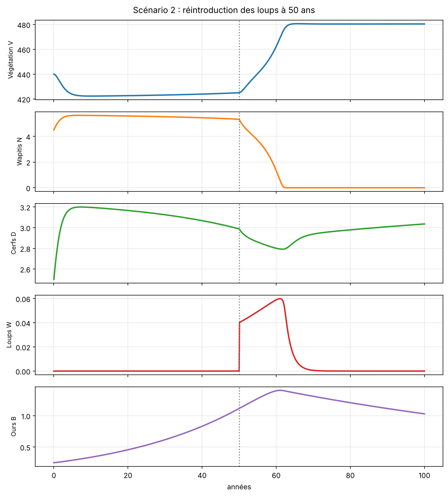

# Cascade trophique à Yellowstone : résolution d'un système d'EDO raide

Simulation d'un écosystème à cinq populations (végétation, wapitis, cerfs, loups, ours) pour étudier l'effet de la réintroduction des loups, avec des schémas numériques codés à la main.

<p align="center"></p>

## Objectif

Résoudre un système de cinq équations différentielles non linéaires couplées, inspiré du parc de Yellowstone. Le système est raide : la chasse varie en quelques mois alors que les populations de prédateurs évoluent sur des décennies. Projet du cours d'équations différentielles de Polytech Nice Sophia.

## Démarche

- Implémentation du modèle (croissance logistique, prédation dépendante du rapport prédateurs / proies, chasse saisonnière).
- Quatre schémas numériques codés à la main : Euler explicite, prédicteur-correcteur, Runge-Kutta 4 et Euler implicite.
- Pour Euler implicite : méthode de Newton à chaque pas de temps, avec une jacobienne calculée par différences finies.
- Comparaison de la stabilité des schémas selon le pas de temps.
- Trois scénarios simulés sur 100 ans : dynamique de base, réintroduction des loups, réintroduction avec une chasse espacée.

## Résultats

- Avec un pas de 0,5 an, RK4 et le prédicteur-correcteur divergent ; Euler implicite reste stable.
- Euler implicite (pas de 0,1 an) donne la même trajectoire que RK4 avec un pas dix fois plus petit.
- La réintroduction des loups fait chuter les wapitis et repousser la végétation : c'est la cascade trophique.
- Avec une chasse tous les 5 ans, loups, wapitis et végétation atteignent un équilibre durable.

## Outils

Python, NumPy, Matplotlib

## Utilisation

Le code et les explications sont dans [`cascade_trophique.ipynb`](cascade_trophique.ipynb).

```bash
pip install -r requirements.txt
jupyter notebook cascade_trophique.ipynb
```
